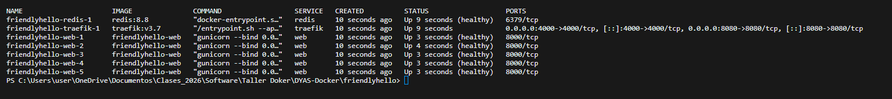
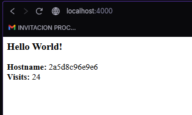
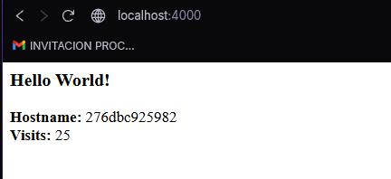
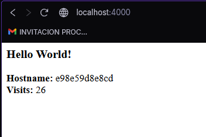
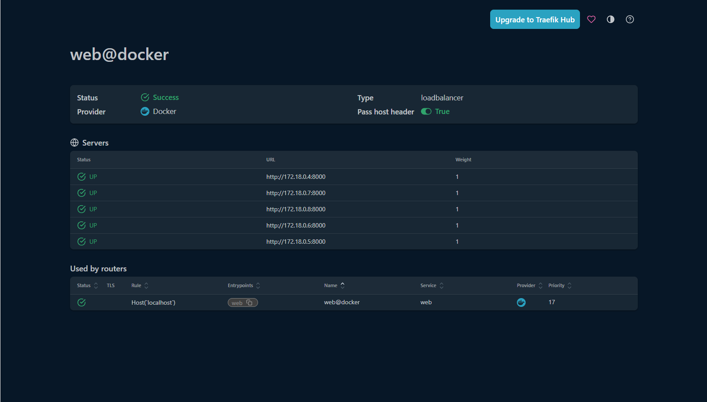

# Balanceo de carga con Traefik (Paso 6)

`friendlyhello/docker-compose.traefik.yaml` agrega **Traefik v3.7** como balanceador:

- `web` ya **no publica puertos**: todo el tráfico entra por Traefik en el puerto 4000.
- Traefik descubre las réplicas leyendo las **labels** de los contenedores (`traefik.enable=true`, regla ``Host(`localhost`)``, puerto 8000).
- Solo envía tráfico a réplicas `healthy`, gracias al `HEALTHCHECK` del Dockerfile.

```bash
docker compose -f docker-compose.traefik.yaml up -d --build --scale web=5
docker compose -f docker-compose.traefik.yaml ps
```

### 5 réplicas en ejecución



### Hostnames distintos (cada petición la atiende una réplica)

| Petición | Hostname | Visits |
|----------|----------|--------|
| 1 | `2a5d8c96e9e6` | 24 |
| 2 | `276dbc925982` | 25 |
| 3 | `e98e59d8e8cd` | 26 |





El contador sigue aumentando porque todas las réplicas comparten el mismo Redis.

### Dashboard de Traefik (http://localhost:8080)



> Se usa `http://localhost:4000` y no `127.0.0.1`, porque la regla del router es ``Host(`localhost`)``.
