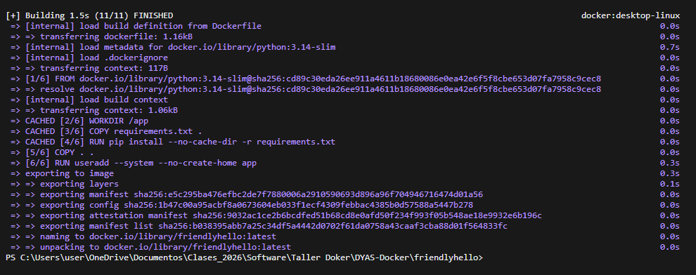
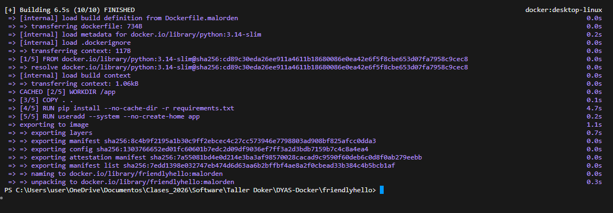

# Caché de capas (Paso 4)

1. Se cambió `Hello` por `Hola` en `app.py`.
2. Se reconstruyó con `docker build --progress=plain -t friendlyhello .`
3. El paso `RUN pip install` aparece como **`CACHED`**: `requirements.txt` no cambió, así que Docker reutilizó la capa.



## Pregunta de discusión: ¿y si `COPY . .` va antes de `pip install`?

Se construyó la variante `Dockerfile.malorden` (código copiado **antes** de instalar dependencias), se cambió de nuevo `app.py` y se reconstruyó:

```bash
docker build --progress=plain -f Dockerfile.malorden -t friendlyhello:malorden .
```



| Orden del Dockerfile | ¿`pip install` usa caché tras cambiar `app.py`? | Tiempo del build |
|----------------------|-----------------------------------------------|------------------|
| Dependencias → código (correcto) | Sí (`CACHED`) | **1.5 s** |
| Código → dependencias (`Dockerfile.malorden`) | No, se reinstala todo (`pip install` tomó 4.7 s) | **6.5 s** |

Con solo cambiar una palabra de `app.py`, el orden incorrecto tardó **más de 4 veces** lo que tardó el orden correcto. Con dependencias más pesadas (por ejemplo, las de Maven en un proyecto Java) la diferencia es de minutos.

**Conclusión:** cada instrucción genera una capa y, cuando una capa cambia, todas las siguientes se invalidan. Si el código se copia antes de instalar dependencias, cualquier cambio en el código obliga a reinstalarlas. Poniendo primero lo que cambia poco (dependencias) y al final lo que cambia mucho (código), los builds son mucho más rápidos.
