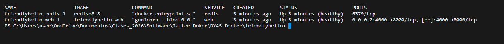

# Docker Compose (Paso 5)

`friendlyhello/docker-compose.yaml` define dos servicios:

- **web**: se construye con el Dockerfile (`build: .`) y publica `4000:8000`.
- **redis**: imagen `redis:8.8` con persistencia (`--appendonly yes`) en el volumen `./data:/data`.

`web` tiene `depends_on` con `condition: service_healthy`, así que solo arranca cuando el *healthcheck* de Redis (`redis-cli ping`) responde. Un `depends_on` sin condición solo esperaría a que el contenedor inicie, no a que esté listo.

```bash
docker compose up -d --build
docker compose ps
```

### Contador de visitas funcionando


### `docker compose ps`



La carpeta `data/` está en el `.gitignore` y en el `.dockerignore`: los datos de Redis no se suben al repositorio ni entran a la imagen.
