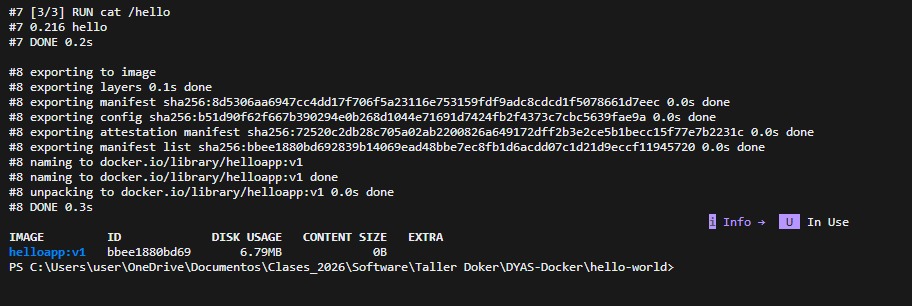
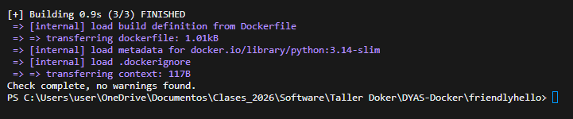
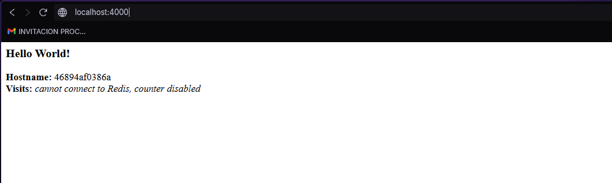
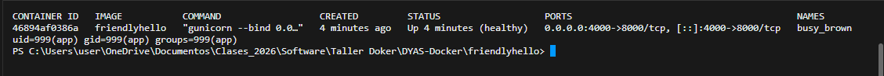

# Imágenes

## Paso 1: primer Dockerfile (`hello-world/`)

```dockerfile
FROM busybox:1.37
COPY hello /
RUN cat /hello
```



## Pasos 2 y 3: imagen `friendlyhello`

| Instrucción | Por qué |
|-------------|---------|
| `FROM python:3.14-slim` | Imagen base oficial y **con versión fija**: el build es reproducible. `slim` reduce el tamaño. |
| `WORKDIR /app` | Directorio de trabajo de la imagen y del contenedor. |
| `COPY requirements.txt .` + `RUN pip install` | Las dependencias se instalan **antes** de copiar el código para aprovechar la caché de capas. |
| `COPY . .` | Copia el código. Gracias al `.dockerignore` no entran `data/`, los archivos de Compose ni `__pycache__`. |
| `RUN useradd ...` + `USER app` | La aplicación **no corre como root**. |
| `ENV NAME=World` | Variable de entorno con el formato `clave=valor` (sin advertencia `LegacyKeyValueFormat`). |
| `EXPOSE 8000` | Documenta el puerto. Es mayor a 1024 porque el usuario no tiene privilegios. |
| `HEALTHCHECK` | Consulta `/health` para marcar el contenedor como `healthy` / `unhealthy`. |
| `CMD ["gunicorn", ...]` | Servidor de producción en vez del servidor de desarrollo de Flask. |

`requirements.txt` con versiones fijas: `Flask==3.1.3`, `redis==8.1.0`, `gunicorn==26.2.0`.

### `docker build --check .` sin advertencias



### Contenedor en ejecución (sin Redis)



### Estado `healthy` y usuario sin privilegios

`docker ps` muestra `(healthy)` y `docker exec <id> id` muestra `uid=999(app)`.


