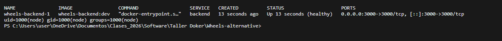
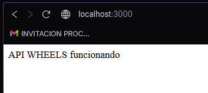

# Proyecto (Parte 4)

Repositorio del proyecto del equipo: **https://github.com/DanielForero14/Wheels-alternative**

Los archivos de Docker están en la rama [`docker`](https://github.com/DanielForero14/Wheels-alternative/tree/docker) (commit `5f07f1e`).

WHEELS es una aplicación de transporte universitario con un **backend en Node.js / Express** (arquitectura hexagonal) y una app móvil en React Native / Expo. El taller propone un ejemplo con Java / Spring Boot; como el backend del equipo es Node.js, se aplicaron **las mismas prácticas** de la Parte 4 adaptadas a Node. La app móvil no se contenerizó porque se ejecuta en el teléfono (Expo) y no en un servidor.

## Dockerfile multi-stage (`backend/Dockerfile`)

```dockerfile
# syntax=docker/dockerfile:1

# Etapa 1: instalar solo las dependencias de producción (las pruebas corren en el pipeline de CI)
FROM node:24.22.2-bookworm-slim AS dependencias
WORKDIR /src
COPY package.json package-lock.json ./
RUN --mount=type=cache,target=/root/.npm npm ci --omit=dev

# Etapa 2: imagen final solo con Node, las dependencias y el código
FROM node:24.22.2-bookworm-slim
ENV NODE_ENV=production
WORKDIR /app
COPY --from=dependencias --chown=node:node /src/node_modules ./node_modules
COPY --chown=node:node package.json ./
COPY --chown=node:node src ./src

# Carpeta de la base de datos SQLite; en Compose se monta un volumen aquí
RUN mkdir /app/datos && chown node:node /app/datos
ENV RUTA_BD=/app/datos/wheels.db

# Usuario sin privilegios que ya trae la imagen oficial de Node
USER node
EXPOSE 3000

# La ruta "/" responde sin depender de servicios externos. La imagen slim no trae curl: se usa fetch de Node
HEALTHCHECK --interval=10s --timeout=3s --start-period=10s --retries=5 \
  CMD node -e "fetch('http://localhost:3000/').then(r => process.exit(r.ok ? 0 : 1)).catch(() => process.exit(1))"

CMD ["node", "src/server.js"]
```

| Práctica | Cómo se cumple | Equivalente en el ejemplo Java del taller |
|----------|----------------|-------------------------------------------|
| *Multi-stage* | La etapa `dependencias` ejecuta `npm ci`; la imagen final solo copia `node_modules` y `src/`. Las pruebas, la caché de npm y los archivos de desarrollo no llegan a la imagen. | Etapa `build` con Maven, imagen final solo con JRE y `.jar`. |
| Orden de capas | `package.json` y `package-lock.json` se copian antes que el código: las dependencias se reutilizan mientras no cambien. | `COPY pom.xml` antes de `COPY src`. |
| Caché de BuildKit | `--mount=type=cache,target=/root/.npm` | `--mount=type=cache,target=/root/.m2` |
| Versiones fijas | `node:24.22.2-bookworm-slim` (versión completa, no `24` ni `latest`) y `npm ci`, que instala exactamente lo del `package-lock.json`. | `eclipse-temurin:21.0.12.1_1-jre-noble` |
| Pruebas fuera de la imagen | `npm ci --omit=dev` y `tests/` en el `.dockerignore`; las 148 pruebas se ejecutan con `npm test` en CI. | `-DskipTests` |
| Usuario sin privilegios | `USER node` (uid 1000). | `USER app` |
| Healthcheck | Consulta `/` con `fetch` de Node, porque la imagen `slim` no trae `curl`. | `curl /actuator/health/readiness` |
| Configuración por entorno | `PORT` y `RUTA_BD` llegan como variables de entorno. | `SPRING_DATASOURCE_*` |

## `.dockerignore` (`backend/.dockerignore`)

```text
node_modules/
tests/
wheels.db
*.log
.git/
.vscode/
.idea/
*.md
.env
.env.*
Dockerfile
.dockerignore
```

`node_modules/` se excluye porque las dependencias se instalan dentro de la imagen para Linux. `wheels.db` se excluye para que la base de datos local no termine dentro de la imagen.

## Docker Compose (`docker-compose.yml`)

```yaml
name: wheels

services:
  backend:
    build: ./backend
    image: wheels-backend:dev
    ports:
      - "${PUERTO_BACKEND:-3000}:3000"
    environment:
      PORT: 3000
      RUTA_BD: /app/datos/wheels.db
    volumes:
      # La base de datos SQLite sobrevive a "docker compose down"; "down -v" la borra
      - datos-wheels:/app/datos
    restart: unless-stopped

volumes:
  datos-wheels:
```

El backend guarda los datos en **SQLite** (librería `sql.js`), un archivo dentro del propio proceso, así que no hace falta un contenedor de base de datos aparte. Ese archivo vive en el volumen `datos-wheels`. Se comprobó que sigue existiendo después de `docker compose down` y `up`.

Para esto se hizo **un solo cambio en el código**: `server.js` lee la ruta de la base de datos de la variable `RUTA_BD`. Si la variable no existe, usa la ruta de siempre, así que `npm start` funciona igual que antes:

```js
const rutaBD = modoCarga ? null : (process.env.RUTA_BD || path.join(__dirname, '..', 'wheels.db'));
```

`.env.example` documenta las variables (`PUERTO_BACKEND`) y el `.env` real está en el `.gitignore`.

## Aplicación corriendo en un contenedor

```bash
cp .env.example .env
docker compose up -d --build
docker compose ps
```

Verificaciones:

- `docker build --check backend`: *Check complete, no warnings found*.
- `npm test`: 148 pruebas, 0 fallos (el cambio en `server.js` no rompió nada).
- El contenedor queda `healthy` y corre como `uid=1000(node)`.



