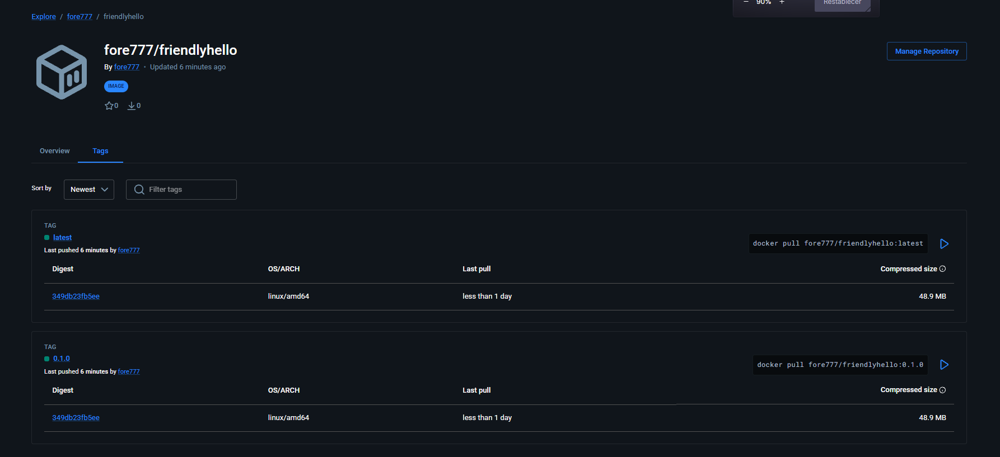
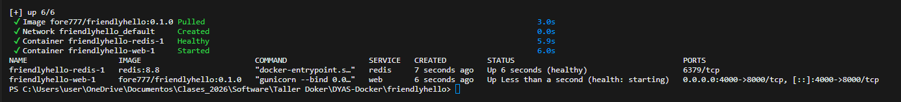

# Registro (Parte 3)

Imagen publicada en Docker Hub:

**https://hub.docker.com/r/fore777/friendlyhello**

```bash
docker login
docker build -t fore777/friendlyhello:0.1.0 -t fore777/friendlyhello:latest .
docker push fore777/friendlyhello:0.1.0
docker push fore777/friendlyhello:latest
```

Las etiquetas `0.1.0` y `latest` apuntan a la misma imagen. En la siguiente versión se publicará `0.2.0` y `latest` se moverá, pero `0.1.0` seguirá disponible.



## Ejercicios

### 1. Compose con mi imagen publicada

En `docker-compose.yaml` se reemplazó `build: .` por:

```yaml
image: fore777/friendlyhello:0.1.0
```

Antes de levantar Compose se borró la copia local de la imagen (`docker rmi`), así que Compose la **descargó de Docker Hub** (`Image fore777/friendlyhello:0.1.0 Pulled`). `docker compose ps` muestra el servicio `web` corriendo con esa imagen.



### 2. Compose con la imagen de un compañero

No se contó con un compañero que hubiera publicado su imagen, por lo que este ejercicio no se realizó. El procedimiento es el mismo del ejercicio 1: basta con cambiar el nombre de la imagen por la de otro usuario, ya que una imagen pública de Docker Hub se descarga sin credenciales:

```yaml
image: <usuario-companero>/friendlyhello:0.1.0
```
